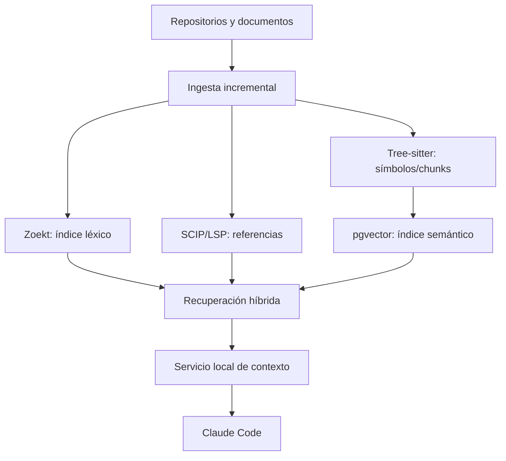

# Arquitectura del Workspace Index

## 1. Decisión recomendada

No construir un único índice vectorial como fuente de verdad. Implementar búsqueda híbrida por capas:

1. **ripgrep + inventario Git** para búsqueda exacta local inmediata.
2. **Zoekt** para búsqueda léxica rápida multi-repositorio y regex.
3. **SCIP/LSP** para definiciones, referencias y relaciones de símbolos.
4. **Tree-sitter** para estructura sintáctica, extracción de símbolos y chunking estable.
5. **PostgreSQL + pgvector** para recuperación semántica de documentación y decisiones.
6. **Sourcegraph** solo cuando exista necesidad real de portal multi-repo, code navigation centralizada, permisos y operación de índices a escala.

Para el MVP y un equipo pequeño, la combinación recomendada es **Zoekt + SCIP/LSP + Tree-sitter + pgvector**. Qdrant y Sourcegraph completo quedan como escalamiento, no como requisito inicial.

## 2. Por qué cada herramienta

| Herramienta | Resuelve | No debe usarse para |
|---|---|---|
| `rg` | Texto exacto, IDs BDD, nombres de campo | Relaciones semánticas complejas |
| Zoekt | Código/texto multi-repo con trigramas y regex | Embeddings o autoridad documental |
| SCIP | Índice persistente de símbolos y referencias | Reglas de negocio en prosa |
| LSP | Navegación viva del workspace local | Índice documental histórico |
| Tree-sitter | AST, símbolos, imports y chunks por unidad | Determinar intención de negocio |
| pgvector | Similitud semántica y filtros SQL | Sustituir búsqueda exacta o permisos |
| Qdrant | Vector search especializado a gran escala | Primera opción si PostgreSQL ya existe |
| Sourcegraph | Portal y búsqueda/code intel multi-repo | Necesidad obligatoria para pocos repos locales |

## 3. Arquitectura lógica



## 4. Unidad de indexación

### Código

- Chunk por función, clase, handler, schema, componente React, hook o migración.
- Conservar `repo`, `commit_sha`, `path`, rango, lenguaje, símbolo, imports y hash.
- Relaciones: definición, referencia, implementación, test y contrato.

### Documentación

- Chunk por sección Markdown, fila de trazabilidad o escenario Gherkin.
- No dividir una tabla o escenario en medio.
- Metadatos: `document_id`, versión, autoridad, módulo, IDs BR/UC/TEST/UX y hash.

### Artefactos ejecutables

- OpenAPI por operación y schema.
- SQL por migración/objeto.
- Eventos por schema/version.
- Tests por ID trazable.

## 5. Esquema mínimo de metadatos

```json
{
  "chunk_id": "sha256",
  "repo": "kairos-api",
  "commit_sha": "...",
  "path": "apps/api/src/modules/reservations/...",
  "kind": "code|bdd|sdd|tdd|ux|openapi|sql|test|adr",
  "authority_rank": 3,
  "module": "reservations",
  "symbol": "ConfirmReservationHandler",
  "trace_ids": ["BR-RES-009", "UC-RES-002", "TEST-RES-INT-001"],
  "content_hash": "...",
  "valid_from": "2026-09-04",
  "superseded": false
}
```

## 6. Recuperación híbrida

Orden:

1. Resolver IDs exactos con Zoekt/`rg`.
2. Expandir símbolos con SCIP/LSP.
3. Recuperar semánticamente solo si la consulta no contiene un ID suficiente.
4. Aplicar filtros por módulo, autoridad y versión vigente.
5. Reordenar: coincidencia exacta > relación simbólica > semántica.
6. Devolver citas con ruta, sección/símbolo, commit y versión.

Un resultado semántico nunca autoriza implementar; solo localiza posibles fuentes que luego deben leerse completas en su contexto.

## 7. pgvector frente a Qdrant

Elegir **pgvector** inicialmente porque KAIROS ya usa PostgreSQL/Supabase, permite filtros relacionales, reduce operación y basta para documentación/código de escala pequeña o media. Separar la base del índice de la base transaccional productiva o, como mínimo, usar proyecto/esquema y credenciales independientes.

Evaluar Qdrant si aparecen millones de chunks, alta concurrencia semántica, replicación independiente, payload filtering intensivo o necesidad de escalar vectores sin afectar PostgreSQL. No migrar por anticipación.

## 8. Sourcegraph y Zoekt

- Usar Zoekt standalone/local como motor léxico inicial.
- Incorporar Sourcegraph si deben indexarse muchos repos, centralizar permisos, exponer una UI de búsqueda/code navigation y automatizar SCIP en CI.
- Nunca enviar código o documentos sensibles a un servicio externo sin aprobación de Seguridad y revisión de residencia/retención.

## 9. Pipeline incremental

```text
git change detected
→ validate source-manifest
→ parse changed files with Tree-sitter/Markdown parser
→ update Zoekt shard
→ generate/update SCIP index
→ embed changed documentation/code chunks
→ tombstone removed/superseded chunks
→ run retrieval golden tests
→ publish index manifest
```

No reindexar todo por defecto. La clave de invalidez es `repo + commit_sha + path + content_hash + parser_version + embedding_model_version`.

## 10. Seguridad

- Índice local o en infraestructura aprobada.
- ACL por repositorio y clasificación documental.
- No indexar el contenido binario de `.env`, secretos, dumps, evidencias, archivos personales, JPG o PNG en Zoekt/SCIP/embeddings de código. Los prototipos aprobados sí se catalogan por metadatos, descripción estructurada, hash y relaciones; la imagen original queda accesible al analizador visual y al runner de comparación.
- Redactar PII antes de embeddings.
- Cifrado en tránsito/reposo y auditoría de consultas.
- Lista de exclusión versionada: `.indexignore`.
- El agente recibe solo fragmentos autorizados y trazables.

## 11. Golden queries del índice

El CI debe responder correctamente, entre otras:

- ¿Dónde se prohíbe `VehicleHold`?
- ¿Qué regla exige GPS y cuál define kilómetros incluidos?
- ¿Qué endpoints ejecutan confirmación de Reserva?
- ¿Qué constraints impiden alquileres solapados?
- ¿Qué formularios funcionan offline?
- ¿Quién puede aprobar el tercer nivel de salida a campo?
- ¿Qué pantallas consumen `BR-DEV-007` y `BR-DEV-008`?
- ¿Cuál es el baseline JPG/PNG aprobado, vigente y por viewport para `ALQ-09`?
- ¿Qué implementación, screenshots y diffs prueban fidelidad para `RES-04`?

Cada respuesta debe devolver la fuente vigente y rechazar documentos superados.

## 12. Integración con Claude

Exponer herramientas de solo lectura vía MCP o CLI controlada:

- `search_exact(query, repos, kinds)`
- `find_symbol(symbol)`
- `find_references(symbol)`
- `search_semantic(query, module, authority)`
- `get_traceability(id)`
- `read_source(path, section)`
- `get_visual_baselines(ux_id, state, viewport)`
- `get_visual_evidence(ux_id, implementation_commit)`

Las herramientas no escriben código ni modifican el índice desde una sesión de implementación. La actualización ocurre en workflow separado y auditable.

## 12.1 Grafo visual obligatorio

El workspace index mantiene la relación:

`UX-ID → UX/UI → PROTO-ID/JPG-PNG → estado/viewport/versión/hash → ruta React → componentes → API → tests → screenshot/diff → aprobación`.

`prototype-manifest.yaml` es la fuente estructurada de este grafo. Los embeddings pueden usar su descripción textual, nunca OCR no revisado como requisito normativo.

## 13. Fuentes técnicas consultadas

- Claude Code: https://code.claude.com/docs/en/sub-agents
- Claude Code skills: https://code.claude.com/docs/en/skills
- Claude Code hooks: https://code.claude.com/docs/en/hooks
- SCIP: https://github.com/scip-code/scip
- pgvector: https://github.com/pgvector/pgvector
- Qdrant: https://qdrant.tech/documentation/
- Tree-sitter: https://tree-sitter.github.io/tree-sitter/
