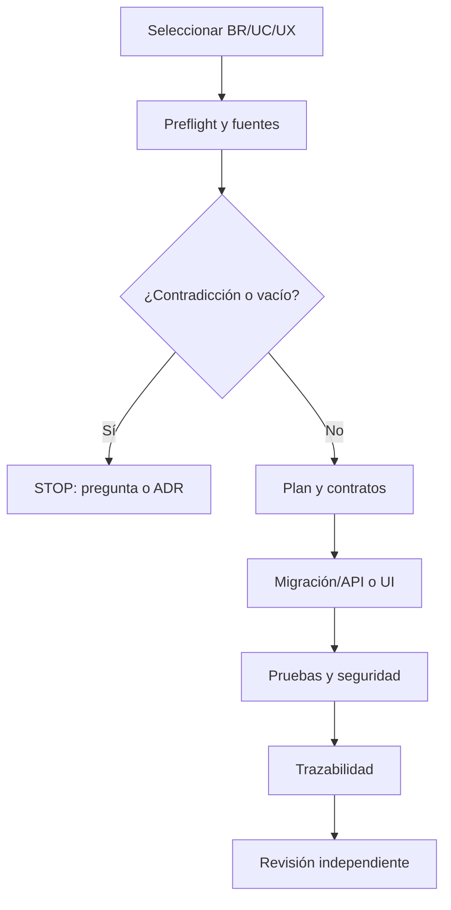

# Trazabilidad, gates y operación de Claude Code

## 1. Estructura propuesta en el monorepo

```text
.claude/
├── agents/
│   ├── shared/
│   ├── backend/
│   └── frontend/
├── skills/
│   ├── shared/
│   ├── backend/
│   └── frontend/
├── commands/
├── rules/
├── hooks/
└── settings.json
CLAUDE.md
apps/api/CLAUDE.md
apps/web/CLAUDE.md
docs/source-manifest.yaml
docs/prototype-manifest.yaml
docs/decision-log.md
docs/conflicts/
artifacts/traceability/
```

Los subagentes viven como Markdown con frontmatter bajo `.claude/agents/`. Las skills viven en directorios con `SKILL.md`. Los workflows reproducibles se exponen como skills/commands y se hacen cumplir con hooks y CI; no deben depender únicamente de un prompt.

## 2. Agentes compartidos mínimos

| Agente | Modo | Responsabilidad |
|---|---|---|
| `source-librarian` | Solo lectura | Resolver fuente vigente, versiones, IDs y contradicciones |
| `traceability-auditor` | Solo lectura | Verificar BDD→SDD→TDD→artefacto→test |
| `architecture-guardian` | Solo lectura/revisión | Validar monolito modular, Clean Architecture y límites |
| `security-reviewer` | Solo lectura | ASVS/API Top 10, multiempresa, secretos, PII |
| `qa-gatekeeper` | Solo lectura/ejecución tests | Confirmar DoD y evidencias; no implementa el mismo cambio |
| `index-maintainer` | Escritura limitada al índice | Actualizar manifiestos e índices, nunca código de producto |

No crear un “mega-agente”. El implementador no aprueba su propio cambio: revisores deben ejecutarse en contexto separado.

## 3. Hooks obligatorios

| Evento | Control |
|---|---|
| Inicio de sesión/tarea | Verificar manifiesto, versión y estado del índice |
| Antes de editar | Exigir task brief con `source_refs`, `visual_refs` y `allowed_paths`; para UI verificar baseline aprobado, hash y viewport |
| Antes de ejecutar shell | Bloquear comandos destructivos, secretos y acceso productivo |
| Después de editar | Detectar paths fuera de alcance, contratos cambiados sin evidencia y pantalla modificada sin captura/diff vigente |
| Antes de commit/fin | Ejecutar lint, typecheck, tests, trazabilidad, seguridad, accesibilidad y `G4-FE Visual Fidelity` |

Los hooks no sustituyen CI. Cualquier hook local puede fallar o deshabilitarse; la rama protegida repite los controles.

## 4. Workflow canónico por slice



## 5. Gates comunes

- `G0 Sources`: manifiesto íntegro, fuentes vigentes y cero contradicción no resuelta.
- `G1 Scope`: archivos y requisitos dentro del slice.
- `G2 Contracts`: OpenAPI/eventos/tipos compatibles y versionados.
- `G3 Build`: format, lint, typecheck y build.
- `G3-FE Stack`: lockfile íntegro, Vite build, cliente OpenAPI regenerado y cero dependencia frontend no aprobada.
- `G4 Tests`: unit, integración, contrato, E2E y concurrencia aplicables.
- `G4-FE Visual Fidelity`: baseline aprobado, captura equivalente, diff, semántica visual, estados, responsive, WCAG y desviaciones aprobadas.
- `G5 Security`: tenant isolation, autorización, secretos, SAST/SCA y PII.
- `G6 Traceability`: todos los cambios enlazados a IDs y pruebas.
- `G7 Review`: revisor separado sin P0/P1 abiertos.

## 6. Matriz de cambio obligatorio

| Si cambia | Debe revisar/actualizar |
|---|---|
| Regla BDD | SDD, TDD, UX, OpenAPI/eventos, pruebas y trazabilidad |
| TDD de datos | Migración, Prisma, repositorio, rollback y tests de DB |
| OpenAPI | Cliente generado, mocks, contract tests y UI consumidora |
| Evento | JSON Schema, productor, consumidor, outbox y compatibilidad |
| Estado de dominio | Command handler, constraints, UI, auditoría y tests |
| Permiso | Policy backend, navegación frontend y pruebas negativas |
| UX/UI | Componentes, responsive, accesibilidad y visual regression |
| Prototipo aprobado | `prototype-manifest`, implementación consumidora, screenshots, diffs, pruebas visuales y aprobación UX/UI |
| Stack frontend/major version | SDD/TDD, ADR, lockfile, agentes, skills y pipeline |

## 7. Estrategia de contexto

1. CLAUDE.md carga reglas breves y enlaces.
2. El agente consulta IDs exactos en el índice.
3. Lee las secciones completas que contienen cada resultado.
4. Adjunta máximo el contexto necesario y sus referencias.
5. Descarta snippets superados o sin versión.
6. Si la recuperación no prueba una decisión, pregunta.

## 8. Definition of Done global

- Implementación dentro del alcance permitido.
- Cero `TODO` funcional sin ticket y fuente.
- Cero endpoint/campo/estado inventado.
- Cero acceso cruzado multiempresa en pruebas negativas.
- Migraciones forward-only y rollback/recovery documentado.
- OpenAPI y schemas validados.
- Cobertura: 100% escenarios críticos; ≥90% dominio crítico; ≥80% líneas/ramas nuevas.
- Accesibilidad WCAG 2.2 AA para UI aplicable.
- 100% de pantallas UI trazadas a baseline JPG/PNG `APPROVED`, salvo excepción explícita aprobada antes de implementar.
- Cero diferencias críticas de estructura, jerarquía o CTA; toda desviación intencional está registrada y aprobada.
- Evidencia de comandos y resultados adjunta.
- Matriz de trazabilidad actualizada.

## 9. Convenciones de salida de agentes

Todo agente responde con: `Verdict`, `Sources`, `Findings`, `Changes`, `Tests`, `Risks`, `Open questions`. Debe distinguir claramente hecho de fuente, inferencia técnica y propuesta.
